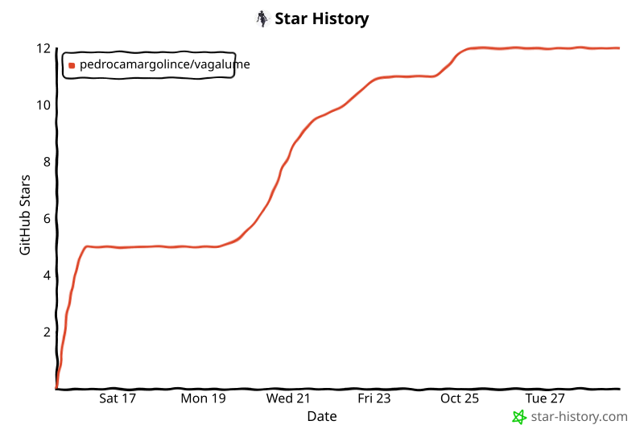

<p align="center">
  <a href="https://pedrocamargolince.github.io/vagaLume/">
    
  </a>
</p>

<p align="center"><a href="../README.md"></a></p>

<p align="center">
  <a href="https://pedrocamargolince.github.io/vagaLume/"></a>
  <a href="https://github.com/PedroCamargoLINCE/vagaLume"></a>
  <a href="GUIDE.md"></a>
  <a href="https://github.com/PedroCamargoLINCE/vagaLume/fork"></a>
</p>

<p align="center">
  
  
  
  
  
  <a href="https://github.com/PedroCamargoLINCE/vagaLume/actions/workflows/radar.yml"></a>
</p>

<p align="center">
  <b>Every internship, research program, fellowship and summer school for students,<br>
  collected once a day and sorted by how well it fits <i>you</i>.</b>
</p>

<p align="center">
  
</p>

---

## Why vagaLume?

Hunting for internships means checking dozens of career pages, a few GitHub
lists, Gupy, and every summer-school site, every single week. *Vaga* is
Portuguese for a job opening, and a *vagalume* is a firefly: vagaLume is a
little light that finds the openings for you.

| | |
|---|---|
| 🌎 **All of Brazil, and the world** | In Brazil: every estágio on Gupy, CIEE (roles and public-sector calls), Super Estágios, Sólides, IEL, Fundação Mudes, Recrutei and the Paraná state Central de Estágios, the Cia de Talentos programs, FAPESP research grants and the internships of multinationals (Santander, P&G, Citi, Bosch, Syngenta…), **over 13,000<!--n:open_brazil--> roles**, most with the stipend shown. Abroad: **over 18,000<!--n:open_abroad--> roles** in the US and Canada, Europe, Asia and remote (also from remote boards such as Himalayas and Remote OK), from big tech, AI labs, trading firms and research programs. |
| 🔭 **46<!--n:sources--> sources, one list** | Plus Greenhouse, Lever, Ashby, SmartRecruiters and Workday boards of 692<!--n:boards--> companies, SAP, IBM, Goldman Sachs, KPMG, Deloitte, the SimplifyJobs lists, Google, Amazon, Microsoft, NVIDIA, Meta, D. E. Shaw, DRW and 92<!--n:programs--> research and summer-program pages. About **32,000<!--n:open--> open roles** on a normal day. |
| 🎯 **Your areas, in the right order** | Tell it which areas you're looking for (not only your course: an engineering student can pick Business too), whether you're doing a Bachelor's, Master's or PhD, where you study and where you'd work (pick as many as apply: *Engineering* and *Computing*, *my state* and *Europe*). Roles for other fields, other levels (PhD-only for an undergrad, and the other way round) and other places are hidden (one click shows them; remote roles always show), and every role gets a dot (good fit, check something, long shot) with the reason, like *"needs US work authorization"* or *"aimed at PhD students"*. |
| 📄 **Match your résumé** | Paste a ready-made prompt and your résumé into the AI chat you already use (ChatGPT, Gemini, Claude…), paste its answer back, and every role shows how well it matches: *"you have 6 of the 10 skills it mentions"*. No AI runs inside vagaLume and your résumé never leaves your hands. |
| 💸 **Pay, when it's stated** | `$54–60/hr`, `R$1,357/mo`, `€1,800/mo`: read from job boards and descriptions in English and Portuguese. |
| ✨ **Today's highlights** | The *Today's highlights* tab shows the 3, 5 or 10 best new roles of the day for you (with your résumé, by what you know), and the vagaLume bot can send them to you every day on Telegram. |
| 📅 **Fits your calendar?** | A tiny January–December strip on every role shows whether it falls in your breaks or clashes with your semester. |
| ⏰ **Deadlines up front** | Closing-soon roles and brand-new ones each get their own tab. |
| ☆ **Your shortlist** | Save, mark as applied, or hide. Filters add up (*ML* and *Data*, *Brazil* and *Remote*) and live in the link, so you can bookmark *"ML roles in Europe"* or send it to a friend. |

<details>
<summary><b>Some of the companies and programs it watches</b></summary>
<br>

**AI labs:** Anthropic, OpenAI, xAI, Cohere, Thinking Machines, Perplexity, Cursor, ElevenLabs, Physical Intelligence, Isomorphic Labs<br>
**Big tech:** Google, Microsoft, Meta, Amazon, NVIDIA, Stripe, Databricks, SpaceX, Cloudflare, Figma<br>
**Trading:** Jane Street, Hudson River Trading, Jump, Optiver, IMC, Two Sigma, D. E. Shaw, DRW, SIG, Five Rings<br>
**Brazil:** every estágio on Gupy, CIEE, Super Estágios, Sólides, IEL, Fundação Mudes, Recrutei and Central de Estágios do Paraná; CIEE estágio calls at courts, BNDES and Fiocruz; Equifax; Nubank, Stone, QuintoAndar, BTG Pactual, XP, Banco Inter, C6, EBANX, VTEX, CI&T, Santander, Itaú, Embraer, Bosch, Syngenta, Ambev (AB InBev)<br>
**Research in Brazil:** FAPESP Oportunidades, CNPEM summer fellowships, ICMC, IME-USP, LNCC, FGV EMAp, Unicamp, UnB and UFCG summer programs, ICTP-SAIFR<br>
**Research programs and schools:** ISTA ISTernship, ETH SSRF, Summer@EPFL, OIST, KAUST VSRP, Mitacs Globalink, Google Student Researcher, Anthropic Fellows, MATS, EEML, OxML, MLSS, Khipu, LatinX in AI, IMPA Summer Program

</details>

## See it


Works on phones too, in light and dark mode. **[Open it →](https://pedrocamargolince.github.io/vagaLume/)**

## Today's highlights

The best new roles of the day for you: by your profile, the areas you pick (from
ML to Tax law, Nursing or Finance) and, once you match your résumé, by what you
know.


## How it works

<p align="center"></p>

Once a day, a GitHub Action runs the Python bot, reads
every source politely (it identifies itself and waits between requests), labels
each posting with keyword rules, optionally asks Claude for sharper labels, and
publishes the result. One failing source never breaks the run, and the site's
Sources table shows which ones worked.

## Run your own in 5 minutes

1. **[Fork this repository](https://github.com/PedroCamargoLINCE/vagaLume/fork).**
2. In your fork, go to **Settings → Actions → General** and choose **Read and write permissions**.
3. Go to **Settings → Pages → Deploy from a branch → `main` / `/docs`**.
4. Open **Actions → vagaLume → Run workflow**. A few minutes later your site is at `https://<your-username>.github.io/vagaLume/`.
5. Make it yours: add companies to [`config/companies.yaml`](../config/companies.yaml), programs to [`config/programs.yaml`](../config/programs.yaml), and searches to [`config/search.yaml`](../config/search.yaml).

Optional: Telegram or email digests and Claude labelling. Setting up the secrets is covered in the [guide](GUIDE.md#secrets-all-optional).

```bash
# or run it on your computer
pip install .
python -m playwright install chromium
python -m radar          # collect everything (about 35 minutes)
python -m http.server -d docs   # then open http://localhost:8000
```

## Learn more

The **[full guide](GUIDE.md)** explains every source and its limits, what each
label and warning means, how pay is detected, how to add a company or a program
page, the code layout (written to be readable by beginners), and the tests.

## Like it? ⭐

If vagaLume helps you find something, **star the repository**. It's the
easiest way to help other students find it too.

<p align="center">
  <a href="https://github.com/PedroCamargoLINCE/vagaLume"></a>
</p>

<p align="center">
  <a href="https://star-history.com/#PedroCamargoLINCE/vagaLume&Date">
    <picture>
      <source media="(prefers-color-scheme: dark)" srcset="assets/stars-dark.svg">
      
    </picture>
  </a>
</p>

<p align="center"><sub>Made in Brazil by an engineering student · <a href="../LICENSE">Apache 2.0 license</a> · no LinkedIn scraping, no sites that block bots</sub></p>
<p align="center"><sub>Credits: IBGE's list of municipalities via <a href="https://github.com/kelvins/municipios-brasileiros">kelvins/municipios-brasileiros</a> (MIT) · Bricolage Grotesque and Schibsted Grotesk fonts in the banner (SIL Open Font License 1.1)</sub></p>
